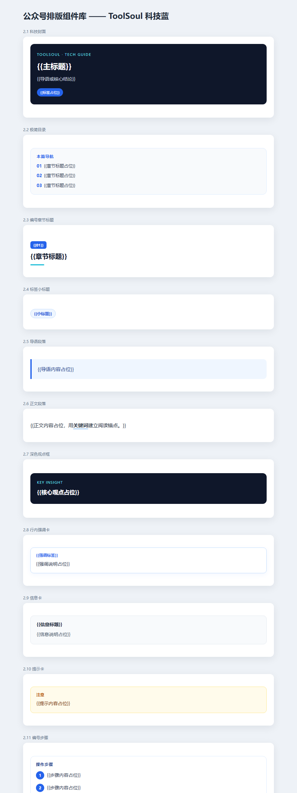
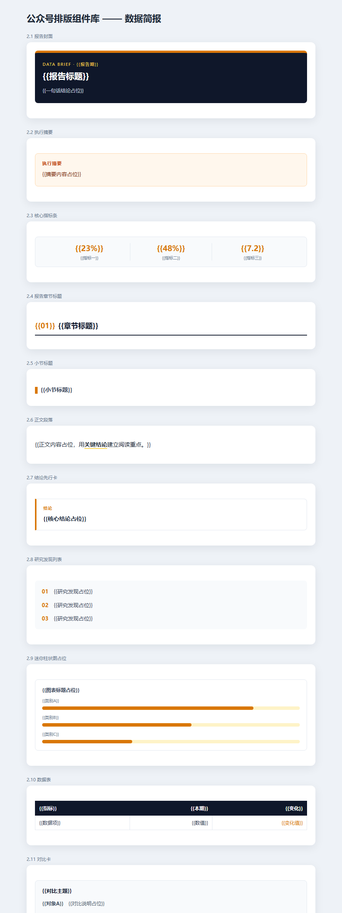

# ToolSoul 器灵AI 公众号写作 Skills

面向 AI Agent 与内容创作者的开源公众号写作技能库，由 **ToolSoul 器灵AI** 维护。

本仓库提供两个可独立使用的 Skill：

- **公众号深度写作**：从素材核验、标题策划、正文写作、去 AI 味，到配图、封面、排版和草稿确认。
- **公众号自动排版**：把 Markdown、Word、PDF 或纯文本转换成可直接粘贴到微信公众号编辑器的 HTML。

适合用于公众号文章创作、AI 写作工作流、微信排版、内容改写、Markdown 转公众号 HTML、Word/PDF 转公众号、公众号封面与配图等场景。

官网：[https://toolsoul.daniu7.cn](https://toolsoul.daniu7.cn)

---

## 包含的 Skills

| Skill | 目录 | 主要能力 | 调用名 |
| --- | --- | --- | --- |
| ToolSoul 器灵AI公众号深度写作 | [`wechat-article-workflow`](./wechat-article-workflow/) | 选题、素材整理、标题、写作、去 AI 味、配图、封面、预览、草稿确认 | `$wechat-article-workflow` |
| ToolSoul 器灵AI公众号排版 | [`gzh-paiban-skill`](./gzh-paiban-skill/) | Markdown/Word/PDF/纯文本转公众号 HTML、自动排版、主题组件、自定义主题 | `$gzh-paiban-skill` |

---

## 核心能力

### 1. 公众号文章写作

- 从热点、文章链接、TXT、Word 或已有草稿中提炼核心事实。
- 生成适配公众号读者和账号定位的标题与文章结构。
- 保留原文事实、数字、人名和事件顺序，减少无依据扩写。
- 提供去 AI 味处理规则，减少模板化排比、空泛金句和翻译腔。
- 输出配图提示词，并优先使用宿主提供的器灵AI图像能力。
- 生成公众号封面、微信兼容 HTML 和发布前预览。
- 支持推送公众号草稿箱前的内容检查和复盘。

### 2. 公众号自动排版

- 支持 Markdown、Word（`.docx`）、PDF、纯文本和网页文本。
- 自动识别文章结构并推荐主题。
- 内置 8 套公众号视觉主题，覆盖科技、数据、观点、教程、生活方式和案例复盘。
- 按教程、观点、清单、测评、案例、人物、报告、随笔等文章类型选择不同布局配方。
- 根据文章标题生成稳定的单篇布局变化，让同一主题下每篇文章也不完全相同。
- 生成纯内联样式的微信兼容 HTML。
- 自动补全 `<span leaf="">`，减少粘贴公众号后样式丢失。
- 内置 HTML 合规校验、组件反模式检查和预览复制页面。
- 支持按描述或参考图生成新的自定义主题。

## 内置视觉主题

| 主题 | 适合文章 | 预览 |
| --- | --- | --- |
| 摸鱼绿 | 教程、测评、清单、工具盘点 | [预览](./gzh-paiban-skill/assets/theme-moyu-green-preview.html) |
| 红白色系 | 深度分析、观点、力量感话题 | [预览](./gzh-paiban-skill/assets/theme-red-white-preview.html) |
| 石墨极简风 | 设计、科技评论、专业观点 | [预览](./gzh-paiban-skill/assets/theme-graphite-minimal-preview.html) |
| 留白禅意风 | 禅意、极简生活、深度随笔 | [预览](./gzh-paiban-skill/assets/theme-zen-whitespace-preview.html) |
| 摸鱼票据风 | 工具对比、创意测评 | [预览](./gzh-paiban-skill/assets/theme-moyu-ticket-preview.html) |
| 橄榄手记 | 案例复盘、内刊手记、深度评测 | [预览](./gzh-paiban-skill/assets/theme-olive-journal-preview.html) |
| ToolSoul 科技蓝 | AI 工具、教程、产品测评、科技观察 | [预览](./gzh-paiban-skill/assets/theme-toolsoul-tech-preview.html) |
| 数据简报 | 行业报告、商业分析、数据复盘 | [预览](./gzh-paiban-skill/assets/theme-data-brief-preview.html) |

> GitHub 文件页不会执行仓库内的 HTML，点击 HTML 链接会看到源码。下载后用浏览器打开可查看完整滚动预览；下面提供直接可看的渲染图。

### ToolSoul 科技蓝



### 数据简报



除视觉主题外，排版 Skill 还会识别文章类型，并从教程、观点、清单、测评、案例、人物、报告、随笔等布局配方中选择宏观结构。单篇变化引擎会依据标题生成稳定签名，让同一主题下的每篇文章不完全相同。

---

## 适用场景

这个仓库适合搜索和解决以下需求：

- 公众号文章写作
- 微信公众号 AI 写作
- 公众号爆款标题
- 公众号文章去 AI 味
- 公众号排版
- 微信排版
- 公众号 HTML 排版
- Markdown 转微信公众号
- Word 转公众号
- PDF 转公众号
- 纯文本转公众号 HTML
- 公众号封面生成
- 公众号配图提示词
- 公众号草稿箱工作流
- 自定义公众号排版主题
- AI Agent Skill
- Codex Skill

---

## 快速开始

### 1. 获取仓库

```bash
git clone https://github.com/ToolSouls/writing-skill.git
```

### 2. 安装 Skill

将需要的 Skill 文件夹放到目标 Agent 的 Skills 目录。

Codex 默认目录：

```text
~/.codex/skills/
```

Windows：

```text
%USERPROFILE%\.codex\skills\
```

安装后目录应类似：

```text
skills/
├── wechat-article-workflow/
│   ├── SKILL.md
│   ├── agents/
│   ├── references/
│   └── assets/
└── gzh-paiban-skill/
    ├── SKILL.md
    ├── agents/
    ├── references/
    ├── scripts/
    └── assets/
```

如果目标应用只支持 ZIP 导入，请分别把两个 Skill 文件夹压缩后导入。

---

## 使用示例

### 写一篇公众号文章

```text
使用 $wechat-article-workflow，
根据下面的素材帮我策划并完成一篇公众号文章：
先提炼核心事实和标题方向，再写正文、去 AI 味、生成配图提示词并完成公众号排版。
```

### 只做公众号排版

```text
使用 $gzh-paiban-skill，
自动选择合适主题，把我提供的 Markdown 排成可以直接粘贴到公众号编辑器的 HTML，
完成后运行兼容性校验。
```

### Word / PDF 转公众号

```text
使用 $gzh-paiban-skill，
读取这篇文章，自动选择主题并转换为微信公众号兼容 HTML。
保留原文结构、图片和重点，不扩写正文。
```

### 生成新的排版主题

```text
使用 $gzh-paiban-skill，
参考这张图的配色和版式，生成一套可复用的公众号排版主题组件库。
```

---

## 设计原则

- **事实优先**：不编造人物经历、采访、研究、统计和案例。
- **自然中文**：减少 AI 腔、翻译腔、模板化排比和空泛说教。
- **公众号兼容**：样式内联化，所有文本节点使用 `<span leaf="">`。
- **渐进式读取**：入口只保留核心流程，详细主题规范和样例放在 `references/`。
- **可扩展**：排版主题和文章工作流都可独立更新、复用和组合。

---

## Skill 目录

### `wechat-article-workflow`

```text
wechat-article-workflow/
├── SKILL.md
├── agents/openai.yaml
├── references/
└── assets/
```

### `gzh-paiban-skill`

```text
gzh-paiban-skill/
├── SKILL.md
├── agents/openai.yaml
├── references/
├── scripts/
└── assets/
```

---

## English

ToolSoul Qiling AI Writing Skills is an open repository for AI-agent-powered WeChat Official Account workflows. It includes two reusable skills for Chinese article writing, human-style editing, illustration prompts, Markdown/Word/PDF-to-WeChat HTML layout, custom theme generation, and paste-ready WeChat formatting.

Search terms: WeChat article workflow, WeChat Official Account layout, AI writing skill, Codex skill, Markdown to WeChat HTML, Chinese content workflow.

---

## 官方与反馈

- ToolSoul 器灵AI：[https://toolsoul.daniu7.cn](https://toolsoul.daniu7.cn)
- GitHub 仓库：[https://github.com/ToolSouls/writing-skill](https://github.com/ToolSouls/writing-skill)

欢迎提交 Issue、改进工作流、补充公众号主题组件或提交 Pull Request。

---

关键词：公众号写作、公众号排版、微信排版、公众号 HTML、Markdown 转公众号、Word 转公众号、PDF 转公众号、公众号封面、公众号配图、去 AI 味、AI 写作、Codex Skill、ToolSoul、器灵AI。
